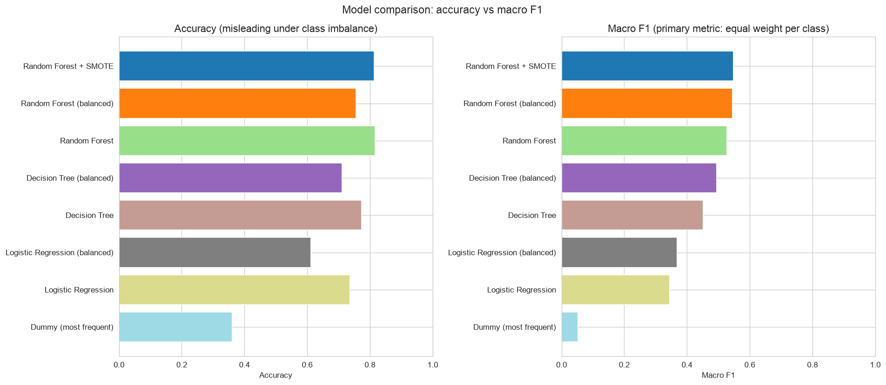
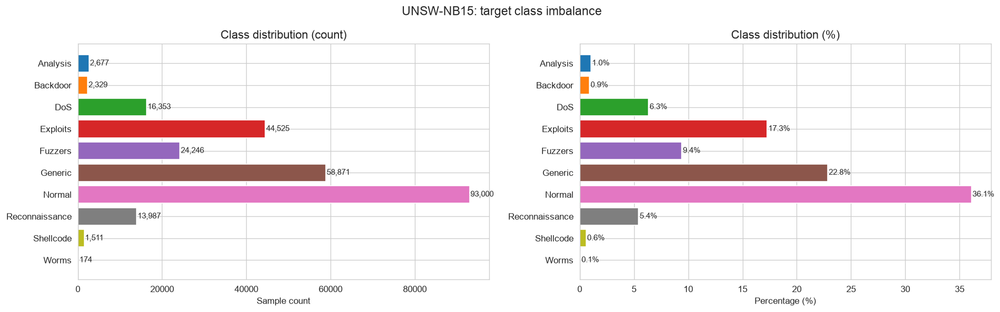
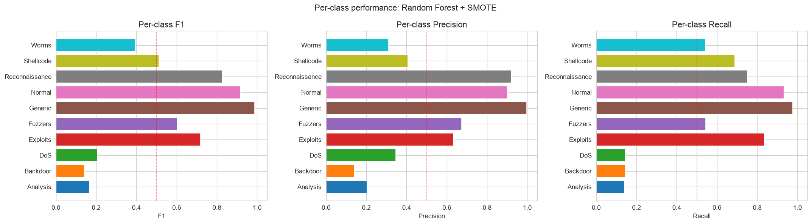
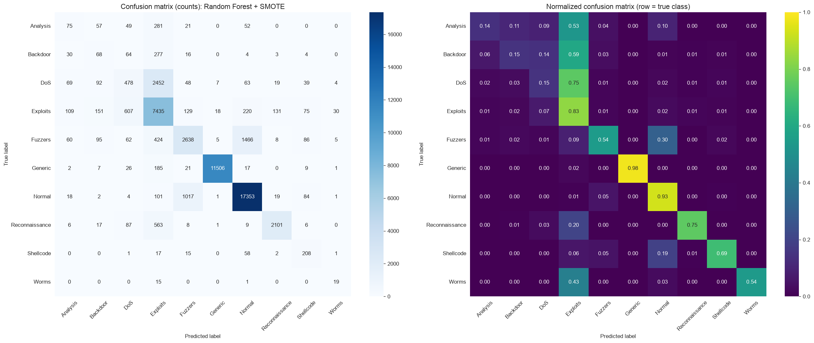
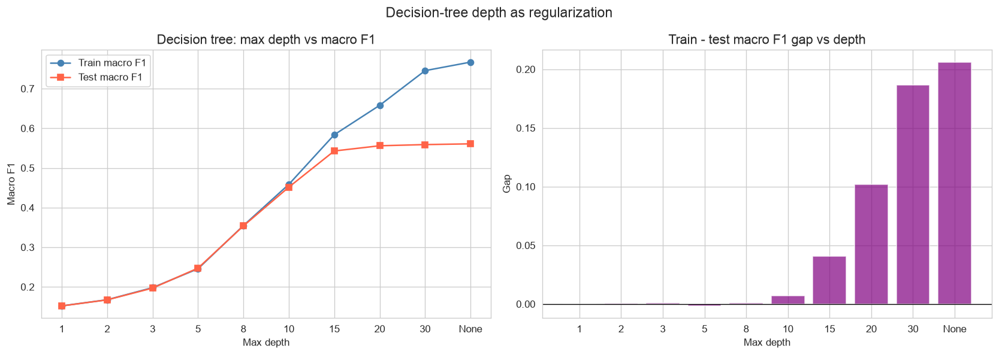
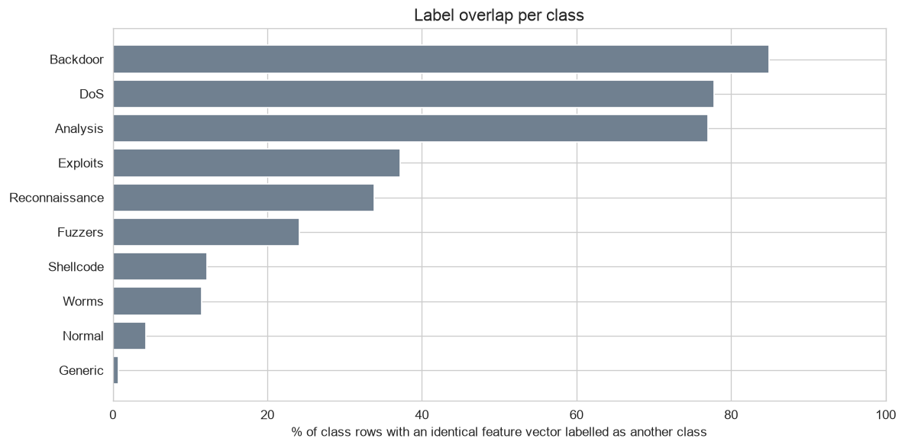
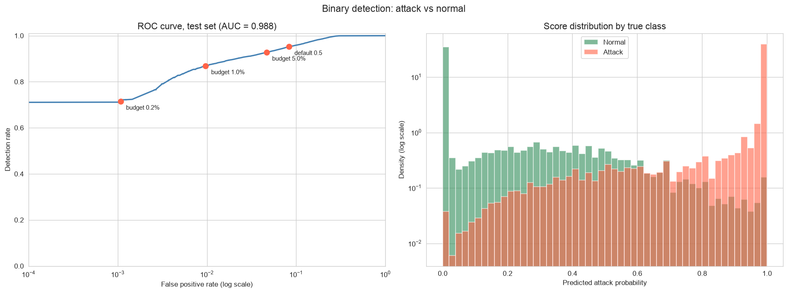
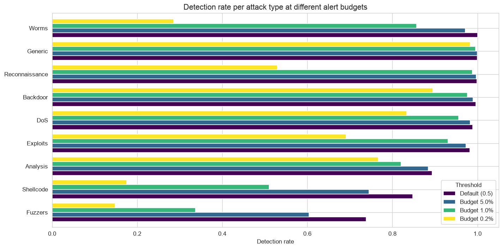
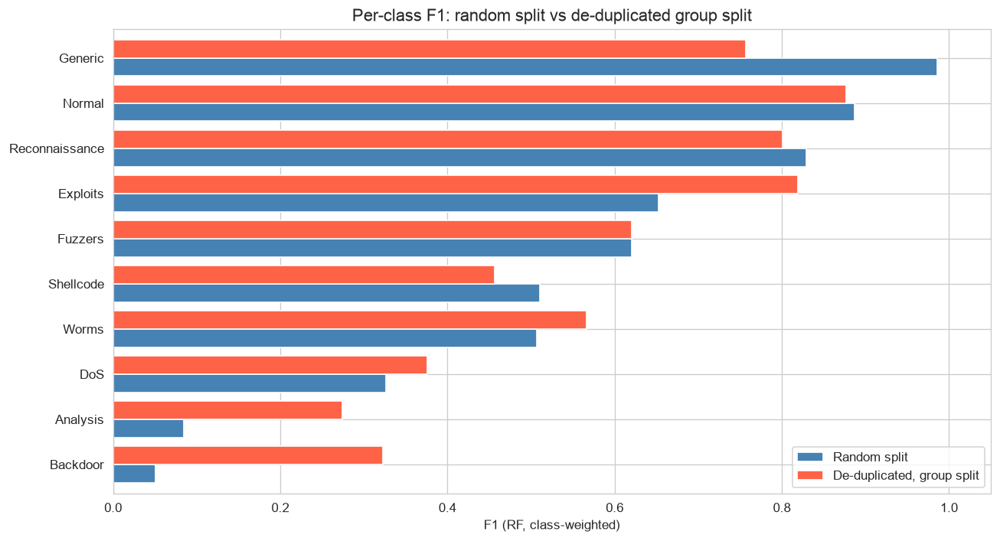

# Network Intrusion Detection with Machine Learning

Multi-class classification of network traffic into **normal traffic** and **nine attack categories**
on the [UNSW-NB15](https://research.unsw.edu.au/projects/unsw-nb15-dataset) dataset, with a focus on
honest evaluation under heavy class imbalance, a bias-variance analysis of where the remaining error comes from,
and an operational (SOC) view of detection rates and false alarms.

## Highlights

- **End-to-end pipeline:** EDA, one-hot encoding of nominal features, leakage-free scaling, stratified splitting,
  baseline models, imbalance handling and per-class evaluation.
- **Imbalance handling:** class weighting and SMOTE compared side by side. SMOTE raises recall on the rarest class
  (Worms, 0.07% of the data) from **0.14 to 0.54** while keeping overall accuracy.
- **Bias-variance diagnosis:** train/test gaps, a regularization (depth) sweep, learning curves, PCA and stratified
  cross-validation.
- **Root-cause finding:** about **19% of all rows share an identical feature vector with a row from another class**
  (85% for Backdoor). This irreducible error, not the choice of model, is what limits the hardest classes.
- **SOC perspective:** binary attack detection with alert thresholds chosen from a false-alarm budget, translated
  into false alarms per day and missed attack types.
- **Honest limitations:** a de-duplicated, group-aware re-split shows how much of the headline score came from
  repeated flows.

## Dataset

| | |
|---|---|
| Records | 257,673 network flows (official train + test sets combined and re-split 80/20, stratified) |
| Features | 31 numeric + 3 nominal (`proto`, `service`, `state`), giving 188 features after one-hot encoding |
| Classes | Normal, Generic, Exploits, Fuzzers, DoS, Reconnaissance, Analysis, Backdoor, Shellcode, Worms |
| Imbalance | 534x between the largest (Normal, 36%) and the smallest class (Worms, 174 rows) |

The data is downloaded automatically from Kaggle ([`dhoogla/unswnb15`](https://www.kaggle.com/datasets/dhoogla/unswnb15))
with `kagglehub` the first time a notebook runs.

## Results

Macro F1 is the primary metric because it weights every class equally. Accuracy is reported for comparison.

| Model | Accuracy | Macro F1 | Weighted F1 |
|---|---|---|---|
| **Random forest + SMOTE** | 0.813 | **0.548** | 0.802 |
| Random forest (class-weighted) | 0.755 | 0.546 | 0.787 |
| Random forest | 0.816 | 0.527 | 0.802 |
| Decision tree, depth 10 (class-weighted) | 0.711 | 0.494 | 0.745 |
| Decision tree, depth 10 | 0.774 | 0.452 | 0.760 |
| Logistic regression (class-weighted) | 0.611 | 0.369 | 0.668 |
| Logistic regression | 0.736 | 0.345 | 0.700 |
| Dummy (always "Normal") | 0.361 | 0.053 | 0.191 |

`Generic`, `Normal` and `Reconnaissance` are detected well (F1 0.83-0.99). `Backdoor`, `Analysis` and `DoS` remain
hard (F1 < 0.25), and most of their errors are predictions of `Exploits`:

## Bias-variance analysis

| Finding | Evidence |
|---|---|
| Tree models have **high variance** | Train/test macro F1 gap of 0.17-0.24 for the random forest and the unrestricted tree |
| Logistic regression has **high bias** | Train and test scores nearly identical at a low level (~0.35); learning curves converge low |
| A depth limit of **15-20** is a good trade-off | Test F1 is 0.543-0.556 vs 0.561 unrestricted, with a much smaller gap |
| **PCA does not help** | 153 of 188 components needed for 95% variance; RF macro F1 drops from 0.545 to 0.48-0.50 |
| Results are **stable** | Stratified 3-fold CV gives the same model ranking (std 0.003-0.016) |

### Label overlap: why some classes cannot be separated

Even a fully grown decision tree only reaches ~0.77 macro F1 *on its own training data*. The reason is that many flows
are identical on every feature but carry different attack labels:

For `Backdoor`, `DoS` and `Analysis` the majority of rows cannot be told apart from other classes using these features.
Further improvement therefore needs richer features (payload- or time-window-based) or merging indistinguishable
categories, rather than more model tuning.

## Operational perspective: what would a SOC see?

A SOC first needs to know *whether* a flow is malicious and how many false alarms the detector creates.
A binary random forest (attack vs normal) reaches a **ROC AUC of 0.988**, and the alert threshold is chosen on a
validation set from a false-alarm budget:

| Alert budget | Detection rate | False positive rate | False alarms/day @ 1M benign flows |
|---|---|---|---|
| Default threshold (0.5) | 95.2% | 8.3% | ~83,000 |
| 5% | 92.8% | 4.7% | ~47,000 |
| 1% | 86.9% | 1.0% | ~9,700 |
| 0.2% | 71.5% | 0.1% | ~1,100 |

- **Detecting *that* is easier than detecting *what*.** Backdoor, DoS and Analysis have F1 below 0.25 in the
  ten-class task, but 89-99% of them are flagged as attacks. A two-stage design fits: a binary detector raises the
  alert, and the predicted category is a triage hint for the analyst.
- **The default threshold would flood a SOC.** Even the strictest budget gives about a thousand alerts a day per
  million benign flows, so per-flow predictions must be aggregated per host or session before they become alerts.
- **There is a false-positive floor.** 0.19% of benign flows get an attack probability of exactly 1.0 because they
  are identical to attack flows, so no threshold can remove them.
- **Strict budgets hide specific attacks.** At the 0.2% budget only 15% of Fuzzers, 18% of Shellcode and 29% of
  Worms are detected. Choosing a threshold means choosing which attacks the organization accepts missing.

## Limitations

**Duplicate records inflate the scores.** Only 56% of the rows are unique (5% for `Generic`). With a random split,
many test flows have an exact copy in the training set. Re-running the evaluation on de-duplicated data, with a
group-aware split that keeps every copy of a feature vector on the same side, gives the results below (both models are
trained on the full training set at threshold 0.5, so the random-split numbers differ slightly from the table above):

| Task | Metric | Random split | De-duplicated, group split |
|---|---|---|---|
| Binary | Detection rate | 0.952 | 0.886 |
| Binary | ROC AUC | 0.989 | 0.975 |
| Binary | False positive rate | 0.080 | 0.081 |
| Multi-class | Macro F1 | 0.546 | 0.587 |

Binary detection drops by about 6.5 percentage points, and `Generic` falls from 0.99 to 0.76 F1, so part of the
headline numbers was memorization of repeated flows. Macro F1 rises because the test set's class composition
changes (Backdoor and Analysis become easier once their duplicated blocks are removed), so it is not a like-for-like
improvement.

**Other limitations**

- UNSW-NB15 is **synthetic lab traffic from 2015**. Attacks, protocols and normal traffic have changed, and far more
  traffic is encrypted today.
- The split is **random, not time-based**, so concept drift is not captured.
- Only **flow-level features** are used, with no payload or host context.
- Identical flows with different labels point to **label noise** or categories that cannot be separated at flow level.
- The models are **not validated on a second dataset** (for example CIC-IDS2017).
- Evaluation is **per flow**, while a SOC works with incidents.

## Tech stack

Python, pandas, NumPy, scikit-learn, imbalanced-learn, matplotlib, seaborn, Jupyter

## License

[MIT](LICENSE)
